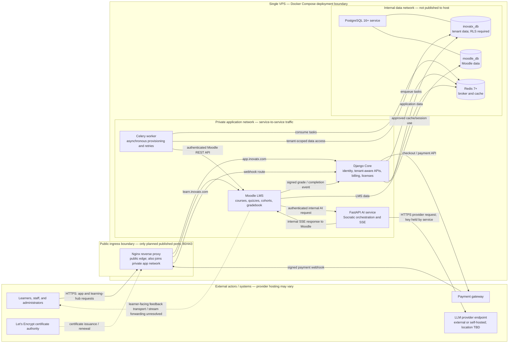

# INOVATX Minimum Viable Architecture Baseline

**Status:** Phase 0 logical baseline; not an implementation or deployment authorization
**Roadmap task:** 0.2.3 — Define the minimum viable architecture
**Scope:** Single-VPS Docker Compose target for the first-client path
**Source of truth:** [Product requirements](inovatx_product_requirements_document_prd.md), [system models](inovatx_uml.md), [environment baseline](inovatx_environment_baseline.md)

This diagram records the target components, primary connections, and trust boundaries for planning. It does not assert that services have been implemented, that this topology is production-ready, or that the stated concurrency and availability targets have been demonstrated.

## Component and trust-boundary view

## Boundary and connection rules

- **External boundary:** Users, payment gateways, and the certificate authority are outside the VPS. The LLM provider may be external or self-hosted; its hosting boundary is not yet decided. Connections crossing a trust boundary require appropriate TLS, authentication, signature validation, and replay/idempotency controls.
- **Public edge:** Nginx is the only planned service with host-published ports. It terminates TLS and routes public application and Moodle requests. Nginx joins both the edge and private application networks to reach its upstreams. FastAPI is not exposed on a public hostname or host port.
- **Application network:** Django, Moodle, Celery, FastAPI, and Nginx communicate over private service networks. Service-to-service calls must authenticate; exact mechanisms and credentials are not specified by this Phase 0 baseline.
- **Data network:** PostgreSQL and Redis are on an internal, unpublished network. One PostgreSQL service hosts the separate logical databases `inovatx_db` and `moodle_db`; these are not separate PostgreSQL containers in this target. Tenant-owned Core data requires PostgreSQL RLS and application-level authorization.
- **Tenant context:** Django requests and Celery work must resolve tenant context explicitly. A missing or invalid tenant context must fail closed; this diagram does not define the implementation.
- **AI boundary:** Moodle makes an authenticated server-to-server request to the private FastAPI service, which returns the modeled SSE response to Moodle. Provider credentials remain service-side. Whether the LLM endpoint is external or self-hosted, and its network placement, are not decided. How Moodle forwards the stream to the learner-facing quiz UI is unresolved; this baseline deliberately does not route browser traffic directly to FastAPI.
- **Payment and LMS events:** Payment webhooks enter through Nginx and Django. Moodle completion/grade events are delivered to Django. Event signature, versioning, idempotency, replay protection, retries, and dead-letter handling follow the approved project decisions.

## Source traceability

| Architecture element or flow | PRD source | UML source | Baseline interpretation |
|---|---|---|---|
| Users enter through Nginx; Django Core and Moodle are public application destinations | §2.1 System Topology; §2.2 Technology Stack | §1 Use Case Diagram; §8 Cloud Architecture | Nginx is the only public ingress and routes to Django and Moodle. |
| Django Core responsibilities and its tenant data | §2.1 System Topology; §3 Multi-Tenancy; FR-04–FR-07 | §5 ERD; §6 Class Diagram; §8 Cloud Architecture | Django owns identity, tenant-aware authorization, billing, and license flows; Core data is protected by RLS plus application checks. |
| Moodle LMS and grade/completion event to Django | §2.1 System Topology; §4 Moodle Integration; FR-02 | §2 BPMN; §7 Sequence Diagram; §8 Cloud Architecture | Moodle is a distinct service; grade/completion events return to Django. |
| FastAPI AI invoked by Moodle; model-provider request | §2.1 System Topology; §5.1–§5.2; NFR-02 | §3 AI Flow Chart; §7 Sequence Diagram; §8 Cloud Architecture | FastAPI remains private and provider credentials stay in the service environment. Authenticated internal calls are required; learner-facing stream delivery remains unresolved. |
| Celery worker, retries, and Redis broker/cache | §2.2 Technology Stack; §4 Moodle Integration; NFR-03 | §2 BPMN; §7 Sequence Diagram; §8 Cloud Architecture | Worker consumes queued work through Redis and calls Moodle; tenant context must be explicit. |
| PostgreSQL with Core RLS data and Moodle database | §2.1 System Topology; §2.2 Technology Stack; §3; NFR-01 | §5 ERD; §8 Cloud Architecture | One PostgreSQL service with two logical databases, matching Task 0.2.2's planning topology; RLS applies to tenant-owned Core tables. |
| Payment gateway checkout and signed webhook | §2.1 System Topology; §4.1 Registration & Payment; FR-02, FR-06, NFR-04 | §7 Sequence Diagram; §8 Cloud Architecture | Checkout is outbound; webhook enters through the public edge and is validated by Django. |
| Public/private/data network separation | §2.1 System Topology; §2.2 Technology Stack; §5.2 Network Access Policy | §8 Cloud Architecture and its deployment gaps | Nginx alone is host-published; app services are private; PostgreSQL/Redis are on an internal data network. |
| Certificate authority and TLS at Nginx | §2.1 System Topology; §2.2 Technology Stack | §8 Cloud Architecture | Let's Encrypt is external; certificate acquisition, renewal, storage, and failure behavior remain deployment work. |

## Explicitly unresolved or unverified

1. **Learner-facing AI streaming:** FastAPI returns SSE to Moodle as modeled, but how Moodle's quiz UI forwards that stream to the learner's browser is not determined. Do not infer a browser-to-FastAPI public route.
2. **LLM hosting boundary:** Whether the provider runs externally or is self-hosted, and the corresponding network/egress path, are not determined.
3. **Service authentication:** Credential format, token lifecycle, key rotation, and authorization between Moodle/Django/Celery/FastAPI require a separate design.
4. **Database bootstrap and roles:** `moodle_db` creation, grants, application-specific database roles, RLS role configuration, and migrations remain to be specified.
5. **Runtime/deployment details:** Exact image tags, application entrypoints, health checks, secrets delivery, TLS configuration, backups, monitoring, resource limits, and upgrade/rollback behavior are not defined here.
6. **Capacity and availability:** The single-VPS target is not evidence of high availability or achievement of the PRD's concurrency, latency, or uptime requirements; these require implementation and measured validation.

## Validation boundary

This document is a logical architecture baseline and traceability artifact only. It does not supersede unresolved items in the PRD/UML, authorize later-phase implementation, or claim runtime, security, performance, or production readiness.
