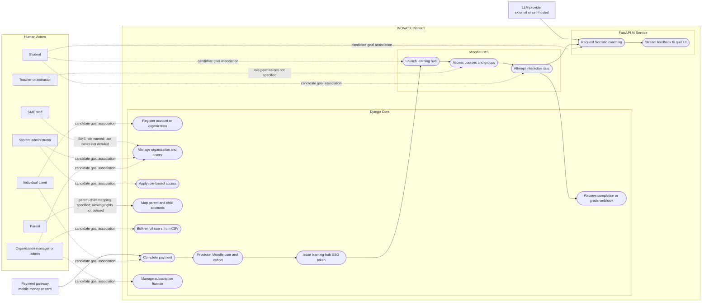
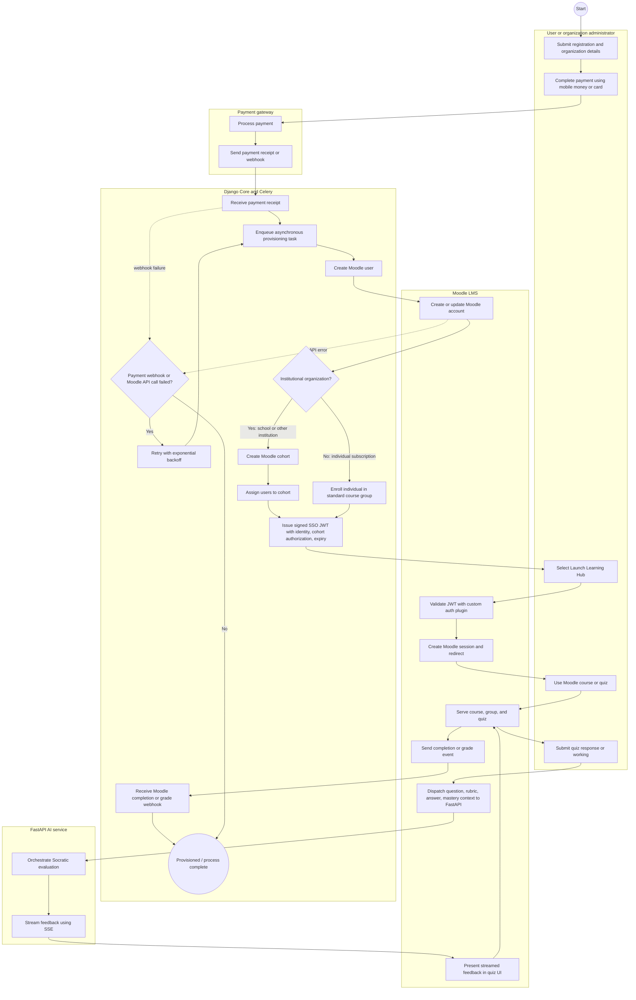
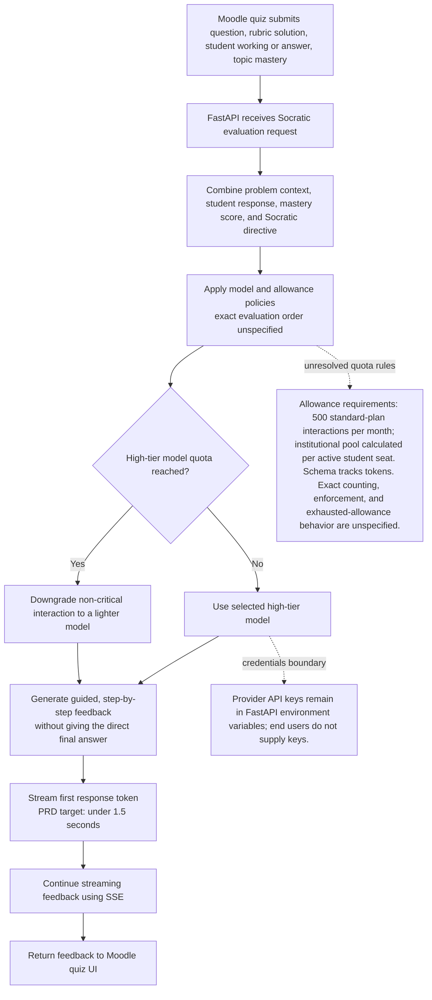
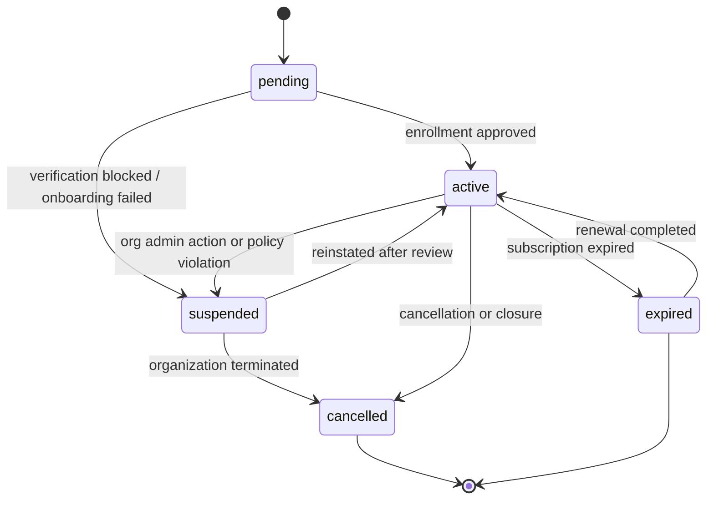
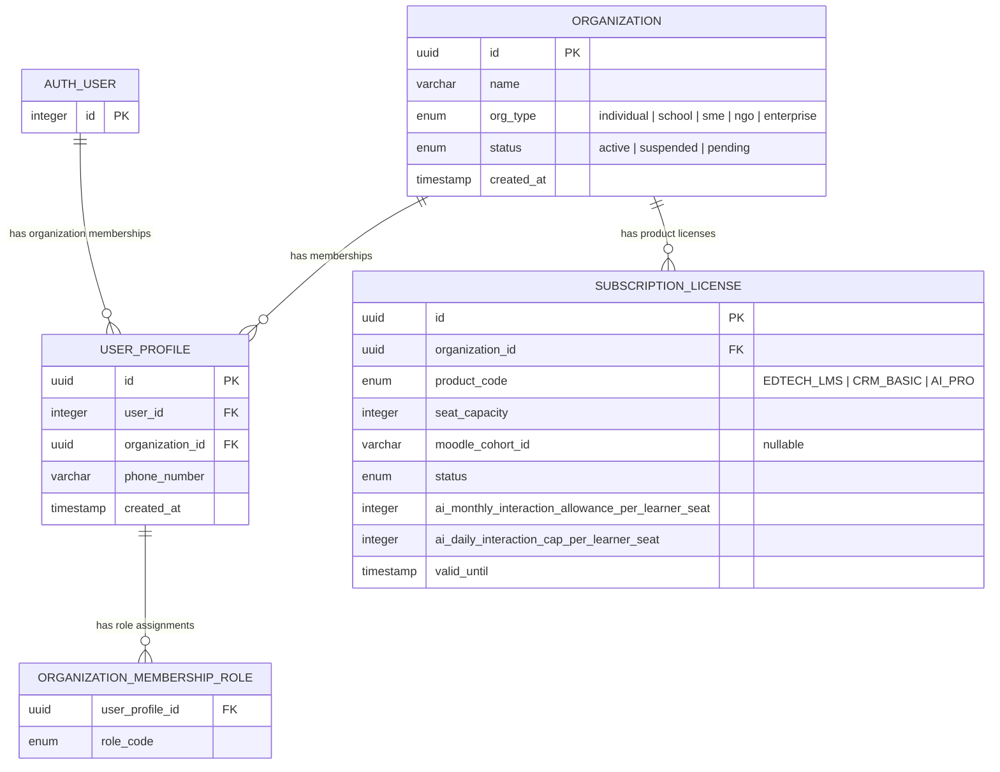
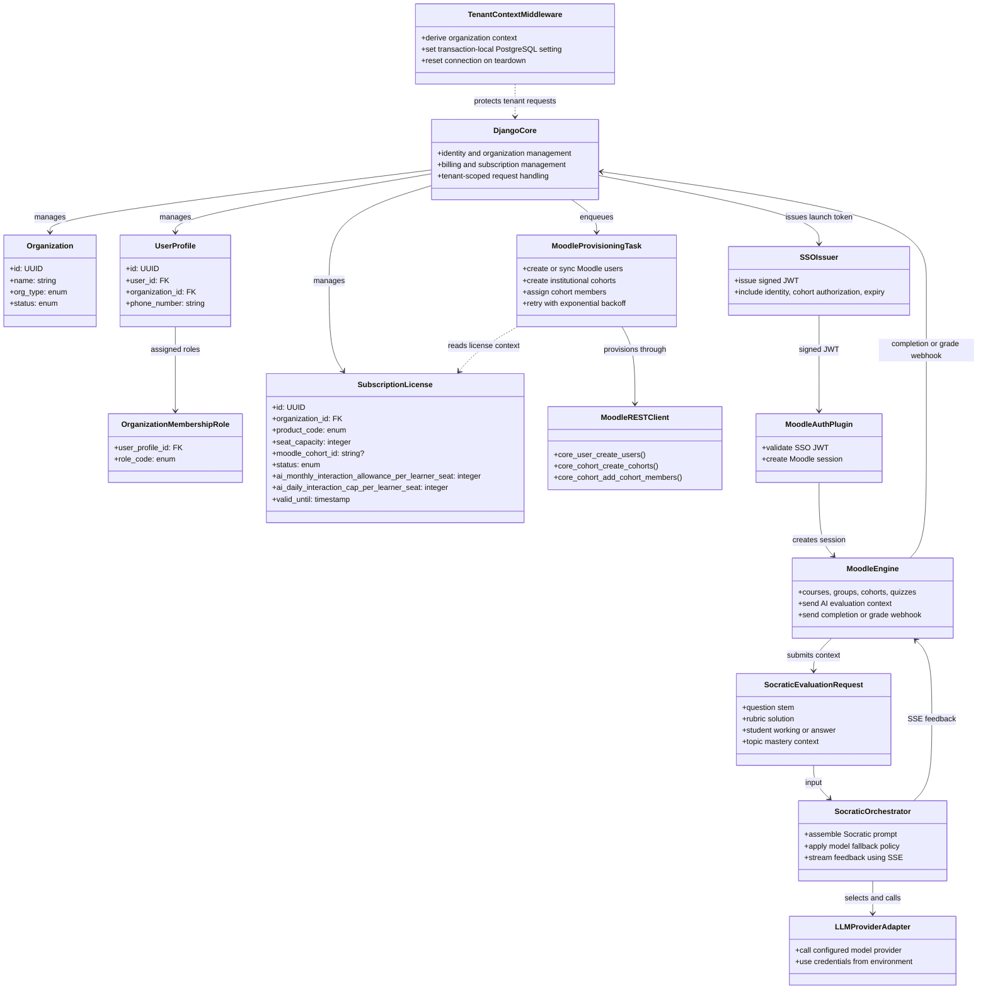
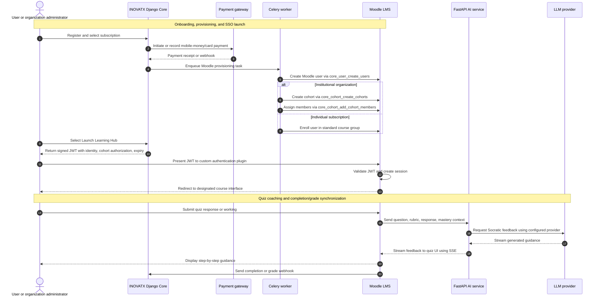
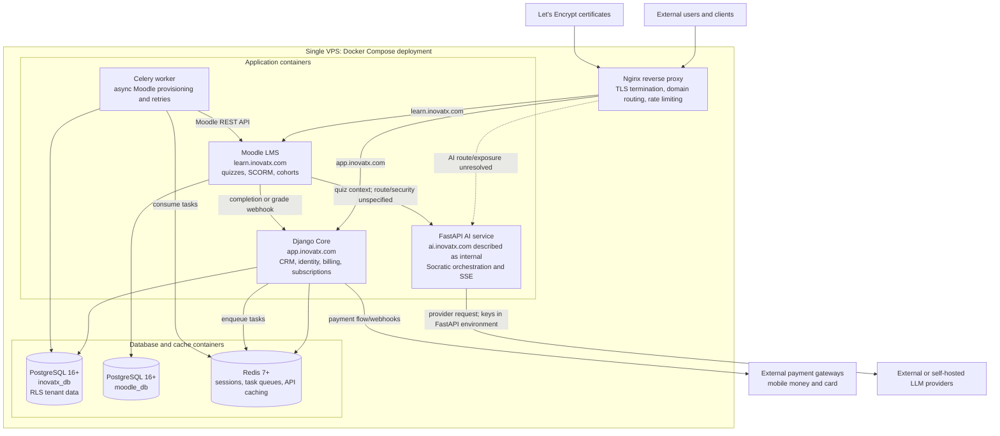

# INOVATX System Models

These diagrams translate the INOVATX PRD into eight system views. They are intentionally limited to facts stated in the PRD. Where the PRD does not define a relationship, lifecycle, permission, or protocol detail, this document marks it as unresolved rather than treating an assumption as a requirement.

## Modeling Conventions

- **Django Core**, **Moodle LMS**, and **FastAPI AI** are separate application boundaries in a hub-and-spoke architecture.
- Payment gateways and LLM providers are external systems. PostgreSQL, Redis, and Celery are infrastructure components.
- Organization types (`individual`, `school`, `sme`, `ngo`, `enterprise`) are data values, not user roles or actors.
- Mermaid has no native use-case or BPMN notation. The use-case view uses a boundary-and-association flowchart; the BPMN view uses participant subgraphs, events, and gateways. They communicate those concepts but are not formal UML Use Case or BPMN 2.0 exchange diagrams.
- Connections between human actors and use cases describe candidate goals, not a final authorization matrix. The PRD names roles but does not map every role to each permission.
- The Class Diagram is a conceptual code-structure proposal inferred from component responsibilities. It is not documentation of an existing implementation.
- **Target-state decision:** distinguish global `system_admin` from tenant-scoped `org_admin`, with other roles realized as membership-specific permissions rather than global user roles.
- **Target-state decision:** maintain separate lifecycle state machines for `Organization`, `SubscriptionLicense`, and `Payment` instead of treating `valid_until` as the full lifecycle definition.
- **Target-state decision:** treat AI allowance as a customer-facing interaction budget that is reconciled against provider-token usage in a usage ledger, while model fallback remains a non-critical interaction policy.
- **Target-state decision:** prefer a private FastAPI service path behind the Django/Moodle trust boundary, with Nginx as the only public reverse proxy and internal service-to-service authentication for AI requests.
- **Target-state decision:** use a single, explicit proxy choice—Nginx—unless the deployment architecture is separately updated to justify Traefik.

## 1. Use Case Diagram: Scope

The system boundary encloses the product responsibilities across Core, Moodle, and AI. External providers are outside it. Role-goal associations are deliberately broad: FR-04 requires distinct permissions, but the PRD does not provide the permission matrix.

**Included scope:** registration, organization and user administration, role boundaries, parent-child mapping, institutional CSV enrollment, payment, licenses, Moodle account/cohort provisioning, SSO launch, course/quiz use, Socratic feedback, and grade/completion synchronization.

**Open scope boundary:** the PRD does not specify detailed CRM or project-management use cases for the future SME/NGO expansion, or permissions for each named actor.

## 2. BPMN: Business Process

This BPMN-inspired view centers on paid onboarding and Moodle provisioning, then shows the learning and coaching continuation. The PRD specifies payment receipt as the trigger for asynchronous provisioning, institutional versus individual enrollment, and exponential-backoff retries for failed payment webhooks or Moodle API calls. It does not specify payment reconciliation or the detailed exception/end states.

**Process notes:** The success path is explicit in the PRD, but the failed-payment outcome, retry count/limits, duplicate-event handling, dead-letter handling, and manual recovery process are not defined. The “No” exit from the retry gateway indicates an unspecified terminal/error outcome, not a prescribed business result. The under-three-second provisioning target is a requirement, but its start/end measurement points and percentile are unspecified.

## 3. Flow Chart: Socratic AI Logic

The flow represents only stated orchestration and fallback behavior. It does not invent a quota-exhaustion response or an exact ordering for usage accounting, prompt creation, and model selection.

**Unspecified logic:** whether the monthly allowance is checked before or after model selection; how “interaction” maps to tokens; how pooled allowance is calculated and reserved concurrently; what response is returned when a student or institution exhausts the allowance; how critical versus non-critical interactions are classified; retry/timeout behavior for provider failures; and how mastery scores are obtained and updated.

## 4. State Machine: Statuses

The PRD explicitly defines the organization status enum, but the implementation needs a fuller lifecycle model. The state diagram below is the recommended target state model after resolving the open decisions: it distinguishes organization status from subscription and payment state, and it defines a suspension and reinstatement path including renewal and expiry behavior.

**Status coverage:** The PRD explicitly supports `pending`, `active`, and `suspended` for `Organization`. The recommended target-state model adds `expired` and `cancelled` because a subscription and organization lifecycle cannot be treated as complete if it lacks renewal, cancellation, and reinstatement semantics. These are not source PRD states; they are design decisions made to resolve the missing lifecycle questions.

**Recommended design decisions:**
- `Organization.status` and `SubscriptionLicense.status` should remain separate. `valid_until` alone is not a complete lifecycle.
- `Payment.status` should be modeled separately as `pending`, `succeeded`, `failed`, and `cancelled` with an event log for retries and webhooks.
- Moodle provisioning tasks should have a retry / dead-letter lifecycle distinct from the license lifecycle.
- AI interaction usage should be tracked in a ledger, not inferred only from a current-month counter.

## 5. ERD: Database

The ERD contains the entities and relationships explicitly described in the PRD. The authentication user represents Django's `auth_user` reference; no extra profile fields are assumed for it.

**Database and isolation constraints:** the PRD places Django application data in PostgreSQL database `inovatx_db` with RLS and Moodle data in `moodle_db`. Because a user may have memberships in multiple organizations, tenant context must be selected from an explicitly identified and validated `UserProfile` membership; the PRD's singular `request.user.userprofile.organization_id` example must not be implemented literally. Middleware injects the validated organization using `SET LOCAL`; tenant tables enable and force RLS; policies compare `organization_id` with the session setting; request teardown resets borrowed connections. Missing, invalid, or unauthorized membership context must fail closed. `student_data` is used as an RLS example, but its schema and relationship are not defined.

**Resolved cardinality for Task 1.1.1:** one auth user may have memberships in multiple organizations, with at most one `UserProfile` per `(user_id, organization_id)`. One membership may have multiple organization-scoped role assignments. An organization may have multiple product licenses, with at most one current license per `(organization_id, product_code)`. These are recorded as project-owner decisions P1.1.1-D1 and P1.1.1-D2 in the Phase 0 decision log. Physical constraints, role enums, and lifecycle behavior remain assigned to their roadmap tasks.

**Schema omissions, not added as requirements:** payments, invoices, renewals, refunds, parent-child links, branches, enrollment records, courses, quizzes, assessments, grades, AI interactions, token-usage ledger entries, audit events, and webhook deliveries. These may be necessary implementation entities, but the PRD does not specify them.

## 6. Class Diagram: Code Structure

This is a conceptual decomposition of responsibilities named in the PRD, not a claim about existing source files or final class names. Django is the central hub; Moodle and the AI service remain separate applications.

**Boundary notes:** RLS is enforced by PostgreSQL as well as application-level tenant scoping. The Django middleware is responsible for tenant-context injection as described; the PRD does not state how Celery background tasks establish tenant context. Moodle API client/task class boundaries and FastAPI request/orchestration/provider classes are reasonable conceptual representations, not prescribed source-code APIs.

## 7. Sequence Diagram: Interaction

Two scenarios share one sequence view: paid onboarding and learning launch, followed by quiz coaching and completion reporting. The exact payment gateway API and webhook security are not defined.

**Interaction details not specified:** payment webhook authentication and idempotency; Moodle API credentials; SSO JWT issuer/audience, signing-key rotation, replay protection, and exact claims; whether the user browser or Moodle mediates the AI connection; authentication between Moodle and FastAPI; webhook retries and event schemas; and whether grade reporting is synchronous or asynchronous.

## 8. Cloud Architecture: Infrastructure

The PRD describes a single high-performance VPS running a Docker Compose deployment. The architecture below includes only named components and links. A single VPS is not, by itself, evidence of high availability or capacity for the stated concurrency target.

**Infrastructure and security constraints from the PRD:** Nginx is the specified web server/reverse proxy, although the topology also names Traefik as an alternative. TLS uses Let's Encrypt. PostgreSQL is version 16+ and Redis is version 7+. Core tenant data uses PostgreSQL RLS plus Django defense-in-depth. FastAPI holds provider credentials in environment variables; end users do not provide keys. Celery retries failed payment webhooks and Moodle API calls with exponential backoff.

**Deployment gaps:** no VPS sizing, container network policy, database backup/restore, disaster-recovery design, monitoring/alerting, log retention, deployment/upgrade strategy, secrets rotation, or horizontal scaling model is specified. The 500-concurrent-quiz-taker target and “100% service uptime” fallback goal need capacity and availability designs beyond what is shown for one VPS.

## Cross-View Traceability

| PRD requirement or statement | Represented in |
| --- | --- |
| FR-01: individual onboarding, parent-child mapping, bulk CSV enrollment | Use cases; ERD omission notes for parent-child schema |
| FR-02: payment receipt triggers Moodle provisioning under 3 seconds | BPMN; sequence; performance caveat |
| FR-03: Socratic feedback and under-1.5-second first token | Use cases; flow chart; sequence |
| FR-04: distinct roles and boundaries in Django and Moodle | Use cases; class view; unresolved role mapping |
| NFR-01: PostgreSQL RLS tenant isolation | ERD; class view; cloud architecture |
| NFR-02: 500 concurrent quiz takers | Cloud architecture; capacity gap |
| NFR-03: exponential-backoff retries | BPMN; class view; cloud architecture |
| Signed JWT Moodle SSO | Use cases; BPMN; class view; sequence |
| Token allowances and model fallback | Flow chart; ERD; sequence; unresolved policy details |
| Single-VPS Docker Compose topology | Cloud architecture |

## Recommended Resolutions to Open Decisions

These actions resolve the major design ambiguities while staying aligned with the PRD. They are the recommended target-state decisions to carry into implementation planning.

1. **Role and authorization mapping:** define a global `system_admin` role and a tenant-scoped `org_admin` role. Normalize `teacher` to `instructor` where product language differs, and treat `student`, `parent`, and `sme_staff` as tenant-scoped membership roles. Enforce permissions by action and resource in Django and Moodle rather than allowing every role to inherit every admin capability.
2. **Organization lifecycle:** keep the PRD states `pending`, `active`, and `suspended` as the minimum lifecycle, and add explicit `expired` and `cancelled` states for product flow completeness. Define `pending → active` as onboarding approval, `active → suspended` as policy or compliance action, `suspended → active` as reinstatement, and `active → cancelled` / `expired` as closure or renewal failure.
3. **Subscription and payment lifecycle:** create separate state machines for `SubscriptionLicense` and `Payment`. Model payment as `pending`, `succeeded`, `failed`, and `cancelled`; model license as `active`, `expired`, `suspended`, or `cancelled`. Keep `valid_until` as a data field, not as the whole lifecycle model.
4. **AI allowance semantics:** map customer-facing `interactions` to internal token accounting. Use a usage ledger to reserve, consume, and reconcile allowance atomically, with monthly reset rules based on billing period. Define the institutional pool as an organization-license calculation derived from active seat capacity rather than ad hoc counts. Downgrade only non-critical interactions when quotas are exhausted.
5. **AI network path:** keep FastAPI on a private network inside the VPS deployment; do not route the AI service publicly unless there is a separate security review. Prefer authenticated server-to-server traffic from Moodle or Django, and use Nginx only as the public edge gateway. If the browser must reach FastAPI, enforce a signed, short-lived user-scoped token and rate limiting.
6. **Integration contracts:** define versioned payload schemas and signed webhook contracts for payment, Moodle, AI, and grade events. Require event IDs, timestamp validation, retry-backoff policies, idempotency, and a dead-letter queue for irreversible failures.
7. **Tenant boundary coverage:** inventory all tenant-owned tables and enforce `organization_id`-based RLS on each. Fail closed if tenant context is missing, and require Celery tasks to resolve tenant context explicitly rather than relying on a global or shared connection thread. Pair RLS with app-level checks and integration tests.
8. **Data model extensions:** add first-class tables for `Payment`, `PaymentEvent`, `AIInteraction`, `UsageLedger`, `Enrollment`, and `GradeRecord` if these are business-critical. Parent-child links and branch-level memberships should also be explicit once the product scope is confirmed.
9. **Operational targets:** define SLOs with percentile targets for provisioning and first-token latency. For example, measure provisioning from verified payment receipt to Moodle enrollment complete, and first-token latency from request acceptance to the first token emitted by the AI service. Add concrete VPS sizing, load-test targets, backup/restore procedures, and alerting requirements before production deployment.
10. **Proxy choice:** standardize on **Nginx** for public ingress, TLS termination, and domain routing. Remove Traefik from the architecture unless there is an explicit operational reason to adopt it, because the PRD already identifies Nginx as the stack’s web server and reverse proxy.
